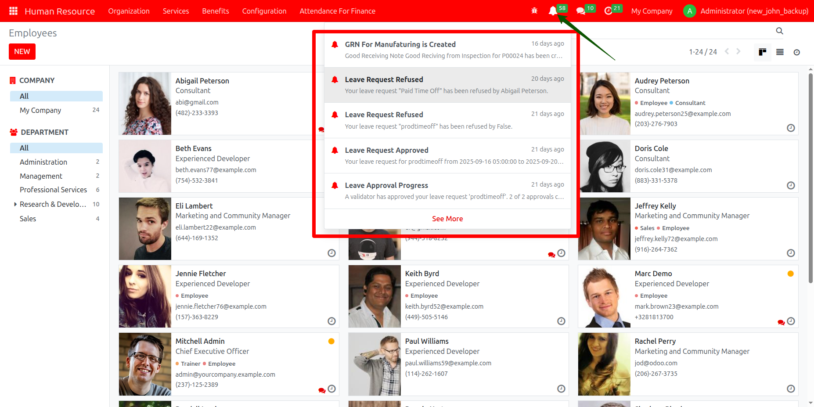

## 🔔 Custom Notification Module for Odoo

### 📘 Overview

The **lami_custom_notification** module for Odoo provides a robust and user-friendly notification system that integrates seamlessly with both backend and frontend. Users receive real-time alerts within the Odoo interface, enhancing productivity and communication.

### 🚀 Features

- ✅ **Notification Model**  
  Stores notifications with fields for:
  - Title & message
  - Related user
  - Read/unread status
  - Associated action data (model, record ID, view mode)

- 🔗 **Dynamic Action Handling**  
  Notifications can link to specific Odoo records, automatically redirecting users to the relevant view or form.

- 💬 **Frontend Interface**  
  - Dropdown in the system tray (systray)  
  - Unread badge count  
  - Relative timestamps (e.g., "5 minutes ago")  
  - “See More” button for pagination

- 🔄 **REST API Endpoints**  
  - Fetch notifications (JSON)  
  - Mark notifications as read

- 💻 **Responsive Design**  
  Styled to blend with Odoo’s UI for a consistent and intuitive user experience.
# 🔔 Custom Notification Module for Odoo

## 📘 Overview

The `lami_custom_notification` module for Odoo provides a robust notification system that allows users to receive and manage notifications directly within the Odoo interface. Notifications appear in the system tray (systray) with a dropdown UI, showing:

- Unread notifications
- Titles, messages, and relative timestamps
- Interactive actions (e.g., redirect to records)
- Pagination support

Fully integrated with Odoo's backend and frontend using OWL (Odoo Web Library).

---

## 🚀 Features

- **Notification Model**  
  Stores title, message, user, read status, and record action details (model, record ID, view mode, etc.)

- **Dynamic Action Handling**  
  Redirect users to relevant records when clicking a notification.

- **Frontend Interface**  
  - System tray bell icon  
  - Unread count badge  
  - Relative timestamps  
  - "See More" button for pagination

- **REST API**  
  - JSON endpoints to fetch and update notification status

- **Responsive & Native Feel**  
  Styled to blend seamlessly with Odoo's UI.

---

## 📦 Dependencies

- Odoo **16.0** (tested on 16.0)
- **No extra Python packages required**
- Uses **OWL** (Odoo Web Library) for frontend

---

## 🛠️ Installation

1. **Clone or Download the Module**
    ```bash
    git clone https://github.com/chalaa/lami_custom_notification
2. copy the cloned folder to the your odoo project
    ```
    cp -r lami_custom_notification /path/to/your/odoo/addons/
3. update you odoo project
    ```
    ./odoo-bin -c /path/to/your/odoo.conf -u lami_custom_notification
###### docker
    docker exec -it <container_name> odoo -u lami_custom_notification -d <your_database>


## ✅ Verify Installation
- A 🔔 bell icon should appear in the system tray
- Create test notifications to validate behavior

## 📁 Module Structure

    lami_custom_notification/
    ├── __init__.py
    ├── __manifest__.py
    ├── controllers/
    │   └── notification_controller.py
    ├── models/
    │   └── notification.py
    ├── static/
    │   └── src/
    │       ├── js/
    │       │   └── notification.js
    │       └── xml/
    │           └── notification.xml
    ├── .gitignore
    └── README.md

## 🔑 Key Files
- __manifest__.py — Metadata & dependencies
- models/notification.py — Notification model logic
- controllers/notification_controller.py — API route handlers
- static/src/js/notification.js — OWL logic for systray dropdown
- static/src/xml/notification.xml — UI template for dropdown

## 💡 Usage
### 📥 Backend
- ### Create Notifications
    ```
    self.env['custom.notification'].create({
        'title': 'New Task Assigned',
        'message': 'You have been assigned a new task.',
        'user_id': user_id,
        'action_model': 'project.task',
        'action_res_id': task_id,
        'action_view_mode': 'form',
    })


### 🖥️ Frontend
- 🔔 Bell icon shows unread count
- 📩 Dropdown lists unread notifications with timestamps
- ✅ Click to mark as read
- 📄 Automatically redirects to linked records
- 📜 "See More" loads more notifications via pagination


## 📸 Screenshot

